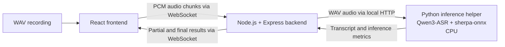

# Speech To Text

A local speech-to-text application built with React, Node.js, and Qwen3-ASR running on CPU through sherpa-onnx.

The application accepts a WAV recording, uploads its audio progressively through WebSockets, and displays transcript revisions followed by a final result.

## Features

- React interface for selecting audio and language.
- Node.js and Express REST API.
- WebSocket audio upload and transcript updates.
- Qwen3-ASR-0.6B with INT8 encoder and decoder.
- CPU inference using sherpa-onnx.
- English, Mandarin Chinese, and Bahasa Indonesia samples.
- WAV format, size, and duration validation.
- Start and Stop controls.
- Upload progress and transcript revisions.
- Live elapsed timers and completed-request performance metrics.
- Resource monitoring and saved accuracy evaluation results.

## Technology stack

| Component | Technology |
| --- | --- |
| Frontend | React + Vite |
| Styling | CSS |
| Backend | Node.js + Express |
| Streaming communication | WebSockets using `ws` |
| Audio transport | 16 kHz, mono, signed 16-bit PCM |
| AI model | Qwen3-ASR-0.6B |
| CPU inference runtime | sherpa-onnx |
| Inference helper | Python standard-library HTTP server |
| Backend-to-helper communication | Local HTTP |
| Resource monitoring | psutil |
| Accuracy evaluation | jiwer |

The current prototype does not use a database.

## Architecture



The React frontend handles file selection, WAV validation, upload progress, transcript display, and browser timing.

Node.js manages the REST API, WebSocket sessions, audio chunks, WAV construction, and inference coordination.

The Python helper loads the model once and reuses it for subsequent requests.

A possible scaling approach is to route requests to a pool of inference workers, each with its own recognizer. Worker count, admission limits, and queue sizes would need validation against CPU, memory, latency, and concurrency measurements. This worker pool is a proposed extension.

## How transcription works

1. The browser validates the selected WAV file.
2. Clicking Start triggers an automatic service-readiness check.
3. The browser opens a WebSocket connection to Node.js.
4. Audio is sent as progressively paced PCM chunks.
5. Node.js constructs WAV snapshots from the audio received so far.
6. The Python helper transcribes each submitted snapshot.
7. Node.js forwards transcript revisions and measurements to React.
8. A final transcript is returned for the complete recording.

The supplied client normally sends 8,000-byte chunks. At 16 kHz, mono, signed 16-bit PCM, each chunk represents 250 milliseconds of audio.

Transcription updates become eligible after approximately four additional seconds of audio have arrived.

Each request transcribes the cumulative recording received so far. This is incremental transcription using repeated offline inference. Model decoding state is not preserved between requests.

Within each session, one inference request runs at a time. Only the latest pending snapshot is retained, allowing obsolete pending updates to be skipped.

Each transcript revision replaces the previous displayed text because earlier words can change as more context becomes available.

The Python helper uses one shared recognizer and permits one inference request at a time.

## Tested environment

| Component | Tested configuration |
| --- | --- |
| Operating system | Windows 11 Home Single Language |
| OS build | 26300 |
| Processor | AMD Ryzen 5 5600H |
| Physical CPU cores | 6 |
| Logical processors | 12 |
| Installed memory | 8 GB |
| Memory visible to Windows | Approximately 7.38 GiB |
| Node.js | 22.14.0 |
| Python | 3.12.4, 64-bit |
| Model | Qwen/Qwen3-ASR-0.6B |
| Runtime | sherpa-onnx 1.13.8 |
| Execution device | CPU |
| Model configuration | INT8 encoder and decoder |
| Recognizer threads | 6 |

These specifications describe the tested machine. Minimum hardware requirements have not been established.

## Installation

The following instructions use Windows PowerShell and assume the project is located at:

```text
C:\BACKEND\STT
```

Adjust the paths if you use another location.

If the application is already installed, continue with **Running the application**.

### 1. Clone the repository

Run this when creating a new checkout:

```powershell
git clone https://github.com/sahanaadiga05/Speech-To-Text.git 'C:\BACKEND\STT'
```

### 2. Install backend and frontend dependencies

```powershell
npm --prefix 'C:\BACKEND\STT\backend' ci
npm --prefix 'C:\BACKEND\STT\frontend' ci
```

These commands install the versions recorded in the corresponding lockfiles.

### 3. Create the Python environment

Python 3.12 must be installed and available through the Windows Python launcher.

```powershell
py -3.12 -m venv 'C:\BACKEND\STT\inference\onnx-test\.venv'
```

Install the saved Python dependencies:

```powershell
& 'C:\BACKEND\STT\inference\onnx-test\.venv\Scripts\python.exe' -m pip install --only-binary=:all: -r 'C:\BACKEND\STT\inference\requirements-onnx.txt'
```

The requirements include packages for inference, audio preparation, resource monitoring, and accuracy evaluation.

The normal ONNX application uses this environment. Earlier PyTorch experiments use a separate environment.

### 4. Download the model

Model files are excluded from Git and must be downloaded separately.

```powershell
curl.exe --fail --location --output 'C:\BACKEND\STT\inference\onnx-test\qwen3-asr-int8.tar.bz2' 'https://github.com/k2-fsa/sherpa-onnx/releases/download/asr-models/sherpa-onnx-qwen3-asr-0.6B-int8-2026-03-25.tar.bz2'
```

The archive download is approximately 838 MiB.

Extract it:

```powershell
tar.exe -xjf 'C:\BACKEND\STT\inference\onnx-test\qwen3-asr-int8.tar.bz2' -C 'C:\BACKEND\STT\inference\onnx-test'
```

The helper expects this model directory:

```text
inference/onnx-test/
└── sherpa-onnx-qwen3-asr-0.6B-int8-2026-03-25/
    ├── conv_frontend.onnx
    ├── encoder.int8.onnx
    ├── decoder.int8.onnx
    └── tokenizer/
```

Keep the directory name and location as shown.

## Running the application

Open the project folder in VS Code.

Use three separate PowerShell terminals, each starting in the project root:

```text
C:\BACKEND\STT
```

### Terminal 1: Inference helper

```powershell
npm run asr
```

This selects the Python executable inside the ONNX environment and starts the inference helper.

Wait for the following message:

```text
Inference helper ready at http://127.0.0.1:8001/health
```

This is expected output, not a command.

### Terminal 2: Node.js backend

```powershell
npm run backend
```

### Terminal 3: React frontend

```powershell
npm run frontend
```

Keep one instance of each service running.

| Service | Address |
| --- | --- |
| React frontend | http://127.0.0.1:5173/ |
| Node.js backend | http://127.0.0.1:3000/ |
| Python inference helper | http://127.0.0.1:8001/ |

Vite forwards `/api` requests and `/ws` connections to Node.js.

### Optional connection check

With all three services running, execute this in another terminal:

```powershell
curl.exe --fail --max-time 10 'http://127.0.0.1:5173/api/inference/health'
```

A successful response includes:

```json
{
  "status": "ready",
  "backend": "Node.js + Express",
  "inference": {
    "status": "ready",
    "model": "Qwen/Qwen3-ASR-0.6B",
    "device": "cpu",
    "runtime": "sherpa-onnx"
  }
}
```

## Using the application

Open [http://127.0.0.1:5173/](http://127.0.0.1:5173/).

1. Select the recording's language.
2. Click **Choose File** and select a supported WAV recording.
3. Click **Start transcription**.
4. The application automatically checks service readiness.
5. Follow the upload progress, transcript revisions, and performance measurements.
6. Wait for the final transcript.

### Demonstration samples

| Language | Dropdown selection | File |
| --- | --- | --- |
| English | English | `samples/english_16k.wav` |
| Mandarin Chinese | Chinese | `samples/noise2.wav` |
| Bahasa Indonesia | Indonesian | `samples/indonesian_original.wav` |

Recordings shorter than the four-second update threshold may produce only a final transcript.

### Stop a session

Click **Stop session** to cancel the current client session.

The elapsed timer freezes. If no final result arrived, the interface identifies the session as ended without a final result.

Starting again begins a new session from the start of the recording.

An inference request already running in the helper may continue until it finishes.

### Shut down the application

Press **Ctrl+C** in each service terminal.

## Performance measurements in the interface

| Measurement | Meaning |
| --- | --- |
| First text latency | Counts live from clicking Start while waiting, then freezes when the first nonempty transcript arrives. |
| Final result time | Counts live from clicking Start, then freezes when the final transcript arrives. |
| Latest inference time | The helper's measured inference duration for the latest completed request. |
| Latest request RTF | Inference duration divided by audio duration for the latest completed request. |

The browser timers refresh approximately every 100 milliseconds.

They start before the automatic readiness check, so their elapsed time includes readiness checking, connection setup, upload, and the subsequent transcription flow.

If the session stops or fails before a final result, the frozen elapsed value does not represent a successful final-result measurement.

Inference time and RTF become available after a model response. Before then, the interface displays waiting or processing states.

During another request, previously completed measurements may remain visible.

The request RTF describes one inference request. It does not include the upload time or the cost of all earlier cumulative requests.

The saved benchmark results below use the Node.js WebSocket test client's timing origin. That test does not perform the browser's automatic readiness check.

## Supported audio

The browser accepts recordings with all of these properties:

| Property | Required value |
| --- | --- |
| Container | Standard RIFF/WAVE |
| Encoding | Signed 16-bit linear PCM |
| Sample rate | 16,000 Hz |
| Channels | 1, mono |
| Duration | More than zero and at most 60 seconds |
| File size | At most 2,000,000 bytes |

A `.wav` extension alone does not guarantee the required encoding.

The interface validates recordings but does not automatically convert unsupported audio.

The original `samples/english.wav` has a different sample rate and bit depth. Use `samples/english_16k.wav` in the application.

## REST API

The Node.js API runs at:

```text
http://127.0.0.1:3000
```

| Method | Route | Purpose |
| --- | --- | --- |
| GET | `/api/health` | Check the Node.js backend |
| GET | `/api/inference/health` | Check the inference helper through Node.js |
| POST | `/api/transcribe` | Transcribe a complete WAV recording |

For transcription, send WAV bytes directly as the request body.

Required content type:

```text
Content-Type: audio/wav
```

Language header:

```text
X-ASR-Language: English
```

Supported language values are `English`, `Chinese`, and `Indonesian`.

### Example transcription request

```powershell
curl.exe --include --max-time 200 --header 'Content-Type: audio/wav' --header 'X-ASR-Language: English' --data-binary '@C:\BACKEND\STT\samples\english_16k.wav' 'http://127.0.0.1:3000/api/transcribe'
```

Successful responses contain:

- Language.
- Transcript text.
- Audio duration.
- Inference duration.
- Real-time factor.

Invalid input returns an error response. A busy model returns HTTP 429.

## WebSocket protocol

Backend address:

```text
ws://127.0.0.1:3000/ws
```

The browser accesses `/ws` through the Vite proxy.

### Client sequence

1. Send a JSON start command.
2. Wait for `session_started`.
3. Send binary PCM chunks.
4. Send a JSON end command after uploading all audio.

Start command:

```json
{
  "type": "start",
  "language": "English"
}
```

End command:

```json
{
  "type": "end"
}
```

Binary audio must be 16 kHz, mono, signed 16-bit little-endian PCM without a WAV header.

### Server messages

- `connected`
- `session_started`
- `chunk_received`
- `audio_ready`
- `processing`
- `transcript`
- `session_ended`
- `error`

A transcript message includes a revision number and a `final` flag.

Each transcript contains the current complete text. Clients should replace the previous text instead of appending the new revision.

## Verification commands

These commands support manual verification. They do not need to run every time the application starts.

### Queue behavior

```powershell
node 'C:\BACKEND\STT\backend\test_transcription_queue.js'
```

Checks that inference tasks do not overlap and that a newer pending task replaces an older pending task.

No running servers are required.

### WebSocket session commands

Keep the Node.js backend running:

```powershell
node 'C:\BACKEND\STT\backend\test_ws.js'
```

Checks the connection and start/end command sequence without transcribing audio.

### Real-audio WebSocket transcription

Keep the backend and inference helper running:

```powershell
node 'C:\BACKEND\STT\backend\test_transcription_ws.js'
```

Uploads the English sample progressively and checks that a final transcript and session completion message arrive.

### Frontend checks

```powershell
npm --prefix 'C:\BACKEND\STT\frontend' run lint
npm --prefix 'C:\BACKEND\STT\frontend' run build
```

- `lint` checks the frontend source using ESLint.
- `build` compiles the production frontend into `frontend/dist`.

The build command verifies compilation. The normal run instructions above use the local Vite development server and its backend proxy.

## Resource monitoring

Keep the backend and inference helper running, with no other transcription in progress.

```powershell
& 'C:\BACKEND\STT\inference\onnx-test\.venv\Scripts\python.exe' -u 'C:\BACKEND\STT\inference\benchmark_resources.py'
```

This script runs one English WebSocket test and samples CPU and memory usage for the existing backend and helper processes.

It saves results in a timestamped directory:

```text
benchmarks/<timestamp>/resources.json
benchmarks/<timestamp>/stream.log
```

The measurements cover the running transcription session. Model startup and loading are excluded.

Process CPU percentages are normalized so that the complete machine represents 100%.

## Recorded results

### English WebSocket stream

The measured recording contained approximately 15.051 seconds of audio.

| Measurement | Recorded value |
| --- | --- |
| First transcript arrival | 9.521 seconds |
| Final transcript arrival | 24.444 seconds |
| Final inference request | 6.010 seconds |
| Final request RTF | 0.399 |
| Peak sampled ASR resident memory | 1,714.77 MiB |
| Peak sampled ASR private memory | 2,660.49 MiB |
| Average sampled ASR CPU usage | 33.42% of the machine |
| Peak sampled ASR CPU usage | 58.66% of the machine |

Transcript arrival times were measured from the WebSocket test client's start.

The final request's RTF applies to that individual inference request. It does not include all earlier prefix requests or the complete streaming session.

Resident memory and private memory describe different measurements. Private memory is not necessarily all resident in physical RAM.

### Separate full-recording REST evaluations

| Language | Recording | Audio duration | Inference time | RTF | Accuracy |
| --- | --- | --- | --- | --- | --- |
| English | `english_accuracy_16k.wav` | 19.020 s | 16.536 s | 0.869 | WER 12.903% |
| Mandarin Chinese | `noise2.wav` | 22.833 s | 15.420 s | 0.675 | CER 18.868% |
| Bahasa Indonesia | `indonesian_original.wav` | 3.713 s | 4.141 s | 1.115 | Not scored; verified reference pending |

English WER and Chinese CER use supplied reference transcripts with the normalization rules recorded in the performance report.

These are individual sample results rather than language-wide accuracy measurements.

### Concurrency observation

A two-client WebSocket test completed one stream successfully. The other received a model-busy error.

This demonstrates the current helper's admission behavior. It does not establish the hardware's maximum concurrent capacity.

### Detailed report

See [the performance report](docs/performance-report.md) for:

- Hardware and runtime configuration.
- Processing approach.
- Latency measurements.
- CPU and memory observations.
- Accuracy calculations.
- Concurrency results.
- Sizing assumptions and estimates.
- Alternative runtime research.
- Limitations and conclusions.

## Limitations

- One inference helper permits one inference request at a time.
- Requests competing for the shared recognizer can receive a busy response.
- Incremental updates repeat inference over cumulative audio.
- Obsolete pending updates may be skipped.
- Transcript wording can change between revisions.
- Stop cancels the client session and does not provide pause/resume.
- An inference request already running may continue after the client stops.
- The 60-second input limit has not been fully resource-profiled.
- Indonesian accuracy remains unscored without a verified reference.
- Maximum hardware concurrency has not been established.
- Large-scale capacity figures in the report are estimates.
- The current application is a local prototype.

## Troubleshooting

| Symptom | What to check |
| --- | --- |
| Browser cannot open port 5173 | Start the frontend with `npm run frontend` |
| Vite reports `ECONNREFUSED` for port 3000 | Start the backend with `npm run backend` |
| Inference health returns HTTP 503 | Start the helper with `npm run asr` and wait for its ready message |
| Startup reports `EADDRINUSE` | Another server occupies the port; check the existing instance before starting another |
| Python cannot import `sherpa_onnx` | Confirm dependencies were installed into `inference/onnx-test/.venv` |
| Model files cannot be found | Check the model directory name and extraction location |
| WAV input is rejected | Check sample rate, channels, encoding, size, and duration |
| Model-busy error or HTTP 429 | Wait for the active inference request to finish |
| Upload reaches 100% but the result is pending | The final inference request may still be running |
| Inference time or RTF initially shows Waiting | A completed model response is required for those measurements |

Earlier errors remain visible in terminal history after a service recovers. Use a fresh health check to confirm its current state.

## Main project directories

```text
backend/
    Express API, WebSocket handling, WAV utilities,
    inference coordination, and Node.js test clients

frontend/
    React interface, browser WAV validation,
    WebSocket client, live timers, and Vite configuration

inference/
    Python HTTP helper, audio preparation,
    benchmark scripts, and saved Python dependencies

inference/onnx-test/
    Local Python environment and downloaded ONNX model;
    excluded from Git

samples/
    Demonstration audio and accuracy reference text

benchmarks/
    Saved transcription, accuracy, and resource results

docs/
    Performance report and architecture source
```

The root `package.json` provides the `asr`, `backend`, and `frontend` startup scripts.

Earlier PyTorch experiment scripts are retained for comparison. They are not required to run the ONNX application.

## Upstream projects and sample sources

- [Qwen3-ASR](https://github.com/QwenLM/Qwen3-ASR)
- [sherpa-onnx](https://github.com/k2-fsa/sherpa-onnx)
- [ONNX model archive](https://github.com/k2-fsa/sherpa-onnx/releases/download/asr-models/sherpa-onnx-qwen3-asr-0.6B-int8-2026-03-25.tar.bz2)
- [Original English demonstration recording](https://qianwen-res.oss-cn-beijing.aliyuncs.com/Qwen3-ASR-Repo/asr_en.wav)
- English and Chinese accuracy recordings and supplied references: the downloaded model archive's `test_wavs` directory.
- [Indonesian sample source](https://github.com/bookbot-kids/speech-recognizer-bahasa-indonesian)